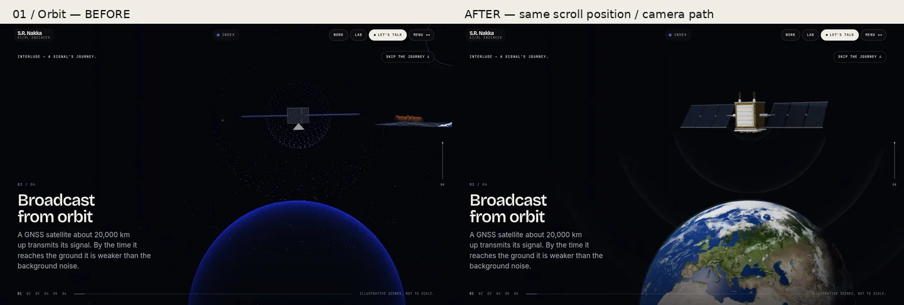
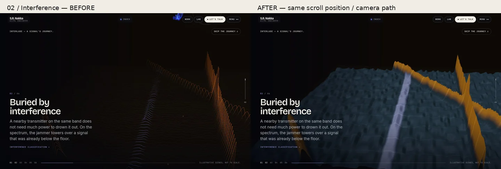
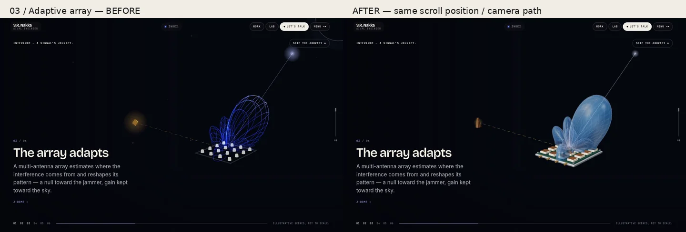
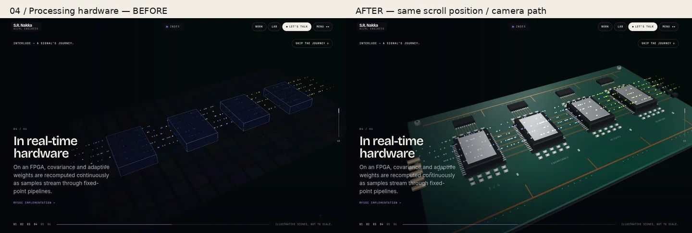
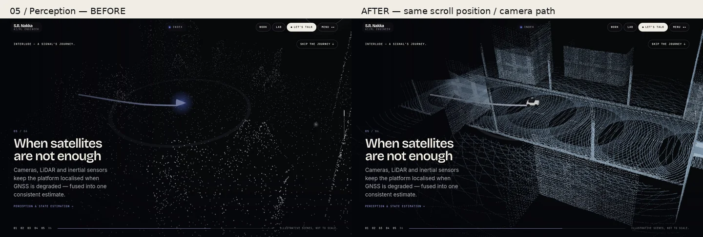
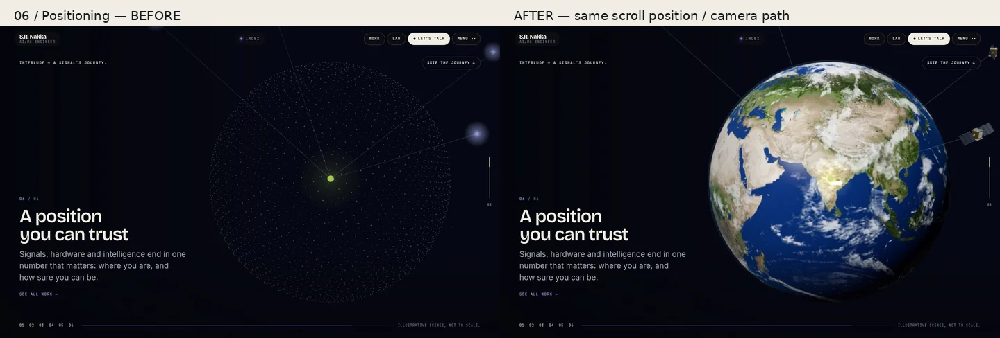

# Matched-scroll visual review

Chrome, 1440×900. Left: commit d552f9e. Right: realism upgrade. Screenshots captured by wheel-scrolling the running application, without changing the camera path. Ambient animation phases differ. The separately referenced video was not available.

